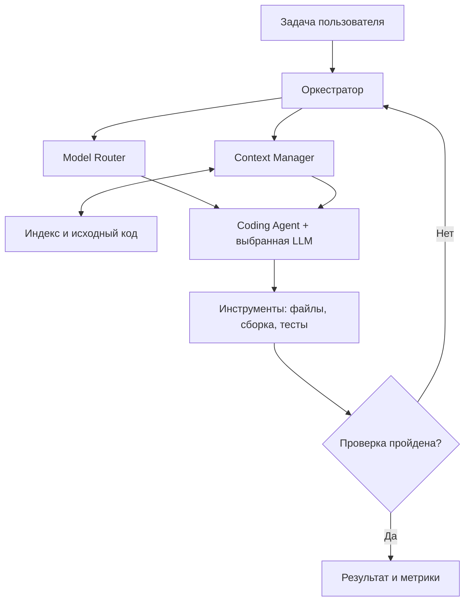
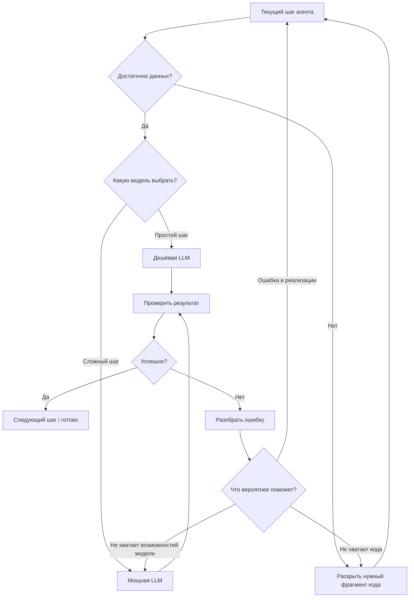
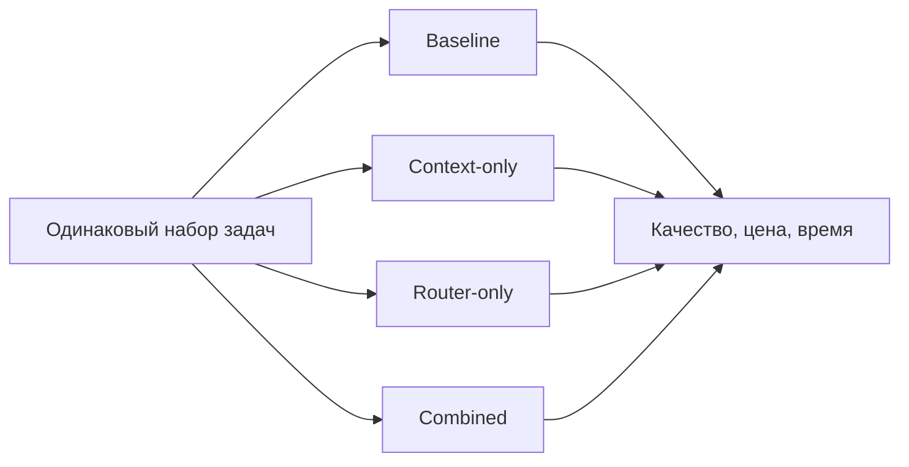

# Adaptive Coding Agent: оптимизация контекста и выбор моделей

## Идея проекта

Хотим сделать систему, которая помогает coding-агенту решать задачи дешевле, но без заметного ухудшения качества. Сейчас агент может тратить много токенов на чтение файлов, которые ему вообще не нужны, или использовать дорогую модель для задачи, с которой справилась бы модель попроще.

У нас две основные идеи:

**Первая — работать с контекстом.** Сначала показываем агенту карту репозитория, а полный код он сможет открыть по необходимости.

**Вторая — выбирать подходящую модель.** Не вижу смысла запускать дорогую модель для каждого поиска функции или простой правки. Но и экономить на сложной архитектурной задаче тоже не стоит.

Самое интересное — научить систему выбирать **между дополнительным контекстом и более сильной моделью**. Если дешёвая модель не справилась, не обязательно сразу переключать её на дорогую. Возможно, ей просто не хватило одной функции или теста.

## Что здесь исследуем

Сжатие кода и выбор моделей уже существуют по отдельности. Поэтому я бы попробовал исследовать **их совместную работу**: как система на каждом этапе понимает, что ей сейчас выгоднее сделать, учитывая стоимость предыдущих шагов, доступный код и ошибки.

Наша гипотеза: *совместный выбор модели и объёма контекста может снизить полную стоимость успешного решения задачи по сравнению с обычным агентом без существенной потери качества*.

Это пока гипотеза, а не обещанный результат. Её нужно проверить экспериментально.

## Общая архитектура

### Из чего состоит backend

| Компонент | За что отвечает |
| --- | --- |
| **Orchestrator** | Ведёт выполнение задачи, хранит состояние шагов и ограничивает бюджет попыток. |
| **Repository Indexer** | Разбирает файлы через AST/tree-sitter, собирает функции, типы, импорты и зависимости. |
| **Context Manager** | Даёт карту репозитория, выбирает релевантные фрагменты и раскрывает оригиналы по запросу. |
| **Model Router** | Выбирает дешёвую или мощную LLM по сложности шага, контексту и истории ошибок. |
| **Agent Runner** | Вызывает модель, предоставляет инструменты чтения и правки кода. |
| **Sandbox & Verifier** | Запускает сборку, линтеры и тесты в изолированном окружении. |
| **Metrics Collector** | Сохраняет токены, стоимость, время, чтения файлов, смены модели и итоги тестов. |

Первую версию можно писать на **Go или Python**. Я бы не стал сразу разбивать всё на микросервисы: нам сначала важно проверить идею. Для истории запусков и метрик хватит PostgreSQL, а индекс репозитория пока можно держать локально. Если начнём с Go-кода, пригодятся `go/ast`, `go/types`, `go/packages`. Если захотим поддерживать разные языки — можно взять tree-sitter.

## Как принимается решение

На старте я бы вообще не обучал никакую нейросеть. Пусть система работает по понятным правилам. Поиск функций можно делать без LLM, небольшую правку попробовать отдать дешёвой модели, а сложный рефакторинг сразу отправить мощной. Если тесты не проходят — разобраться, почему. Возможно, надо показать модели другой файл, а возможно, действительно сменить модель. Когда накопим данные, сможем попробовать обучаемый маршрутизатор.

Важно: модель не должна сама объявлять, что задача решена. Успех подтверждается проверками — сборкой, тестами и, если возможно, независимыми скрытыми тестами.

## План разработки

### Этап 1. Делаем обычного рабочего агента

Для начала подключаем две модели через единый интерфейс. Агент должен уметь искать и читать файлы, менять код, запускать сборку и тесты. Всё это лучше выполнять в отдельном контейнере с ограничениями, чтобы один неудачный запуск не мешал остальным. Сразу сохраняем историю запросов, стоимость и время работы. Получим базовую версию, с которой потом будем сравнивать наши улучшения.

### Этап 2. Добавляем карту репозитория

Разбираем проект на файлы, функции, типы и зависимости. Вместо огромного снимка всего кода сначала отдаём агенту короткую карту. Если ему нужно разобраться в реализации функции или посмотреть тесты — он сможет открыть оригинал. Сам исходный код никуда не пропадает.

### Этап 3. Учимся выбирать модель

Разделяем работу на этапы: поиск, анализ, изменение и проверка. Добавляем простые правила, когда вызываем дешёвую модель, а когда дорогую. Обязательно ограничиваем число попыток и бюджет. Если что-то пошло не так, агент должен не просто повторять запрос, а попробовать раскрыть другой код или сменить модель.

### Этап 4. Пробуем свой алгоритм

Когда всё заработает, соберём историю реальных задач. Посмотрим, какие модели справлялись, сколько файлов им требовалось, на чём они ошибались и сколько стоила каждая попытка. По этим данным можно будет построить алгоритм, который оценивает, какое следующее действие даст лучший шанс на успех за разумные деньги. И обязательно сравним его с нашими первыми простыми правилами.

## Как проверять эффективность

Нужно запускать **одинаковые задачи на одинаковых коммитах** и сравнивать четыре режима:

| Режим | Контекст | Модель |
| --- | --- | --- |
| Baseline | Обычные инструменты агента | Одна фиксированная |
| Context-only | Адаптивное раскрытие кода | Одна фиксированная |
| Router-only | Обычные инструменты агента | Выбирается динамически |
| Combined | Адаптивное раскрытие кода | Выбирается динамически |

Для честного сравнения нужны одинаковые задачи, исходный код, модельные настройки, лимиты и независимые тесты. Желательно несколько повторов на задачу. Начать можно с 20–30 задач, но для сильных выводов потребуется больше данных.

Смотреть будем в первую очередь на **долю успешно решённых задач** и **полную стоимость одного успешного решения**. Дополнительно измерим входные, выходные и кешированные токены, время выполнения, количество повторных чтений кода и переключений между моделями. Стоимость индексатора и проверки тоже надо учитывать. Потому что если один запуск стал дешевле, но агент начал ошибаться вдвое чаще, пользы от такой оптимизации мало.

## Когда можно считать первую версию готовой

Когда у нас будет агент, который умеет менять код и запускать тесты, читать карту репозитория и открывать оригиналы, работать хотя бы с двумя моделями и сохранять статистику каждого запуска. После этого мы должны суметь прогнать одну и ту же задачу в четырёх режимах и посмотреть, что изменилось по качеству, цене и времени.

## Что пока не делаем

Не стоит пока обучать собственную LLM, городить распределённую архитектуру или пытаться поддержать все языки сразу. Я бы начал с Go-репозиториев, простых правил и нормальных воспроизводимых экспериментов. Если идея сработает, усложнить систему всегда успеем.
